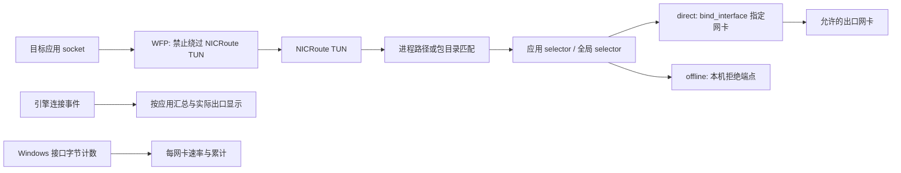

# NICRoute 测试机开发交接

本文供测试机上的 Codex 接手测试、定位问题和继续开发。基线日期：2026-10-29。先核对实际检出的提交，本文中的版本和断言数是该基线的记录，不是后续版本必须保持的常量。

**第一优先级：真实 TUN + WFP + 双网卡端到端验收。现有 CI 通过不能替代这一验收。用户明确要求“不联网”不能靠外网连通性探测来实现，也不能偷偷使用系统跃点选择另一张网卡。**

## 1. 先读这些文件

| 文件 | 用途 |
| --- | --- |
| [README.md](../README.md) | 用户功能、已知边界、基本构建方法 |
| [本交接文档](development-handoff.md) | 接手顺序、关键实现、测试矩阵、开发约束 |
| [v0.2.3 发布说明](releases/v0.2.3.md) | 当前实现范围 |
| [更新实现说明](updates.md) | 更新协议、信任边界、安装与回滚、发版流程 |
| [发布工作流](../.github/workflows/release.yml) | 可重复的构建及发布入口 |
| [第三方许可](../THIRD-PARTY-NOTICES.md) | 引擎、MUDL、运行时的来源与许可 |

## 2. 当前基线与历史决定

| 项目 | 基线 |
| --- | --- |
| 仓库 | https://github.com/daxiaamu/NICRoute |
| 已发布版本 | [v0.2.3](https://github.com/daxiaamu/NICRoute/releases/tag/v0.2.3) |
| 应用源码提交 / Release 标签目标 | `b5dad8a672a83e9eaca1f211148bffd6f980c994` |
| 更新清单提交 | `313226f`，在应用提交之后，只增加发布元数据 |
| 成功的 Actions 记录 | https://github.com/daxiaamu/NICRoute/actions/runs/40902149602 |
| 应用版本 / VersionCode | `0.2.3` / `5` |
| stable policyRevision / 强制边界 | `5` / `0`，当前更新可选 |
| Windows / UI / SDK | Windows 10、11 x64 / WPF / .NET 10 SDK；CI 固定 `10.0.100` |
| 自包含运行时 | .NET `10.0.14`，与 SDK 版本分别管理 |
| 分流引擎 | sing-box `1.14.4`，官方 Windows amd64 构建 |
| 更新下载器 | MUDL-C `0.5.14`，Windows x64，最多32连接 |
| 运行包 SHA256 | `686963b5168990f2b17b91cab909c7b3685241b6312739733dbca8de28e6b5a8` |
| 运行包大小 | `104867603` 字节，指上述正式 Release 附件 |

本次新增的交接文档位于仓库 `main`，不会回写已经发布的 v0.2.3 ZIP。交接时优先克隆或更新仓库；如果只拿到旧源码 ZIP，还需另取本文。

必须保留的用户决定：

- 支持按名称选择 Windows 应用（UWP / Store / MSIX），同时支持桌面 exe；不要退回到只填 exe 路径。
- 每应用首选网卡、全局默认网卡、三种回退：不联网、全局默认、指定其他网卡。备用也不可用时阻断。
- **禁止把“默认开启联网探测”当成“不联网”约束的修复。** `ProbeInternet` 默认 `false`；现有可选检测功能可以保留，测试主用例应关闭它。
- 用户报告的场景是：首选网卡仍连接、有 IP，但不能上网；设置“不联网”后仍观察到别的网卡承载流量。尚未在原网络端到端复现并确认修复。
- 监控要区分网卡总量、应用连接负载、规则出口预览、当前连接出口和最近出口，不能互相冒充。
- 布局保持紧凑：全局网卡、保存、启停在顶部同行；卡片只显示 ↑/↓ 和速率；网卡数量与刷新位于底部。
- 限速已明确延期，本轮不要顺便加入限速或重构成新的数据转发层。
- 更新使用 MUDL，多镜像共同下载；官方 GitHub 为权威源，镜像完整哈希验证后才可作为下载备用。不要求凑齐5个镜像。
- 用户已持续授权使用当前 GitHub Actions 发布工作流。按已有流程发布，不移动既有标签或覆盖已发布资产；本机仍需使用合法可用的 GitHub 登录，不能把令牌写入源码、文档、日志或包。

## 3. 从空测试机开始

需要 Git、PowerShell 7、.NET 10 SDK。构建通常不需要管理员；实际 TUN 和 WFP 测试需要当前进程具有管理员令牌。工具的“提升沙箱权限”不等于 Windows UAC 管理员令牌。

```powershell
git clone https://github.com/daxiaamu/NICRoute.git
Set-Location NICRoute
git status --short
git log -3 --oneline
dotnet --info
pwsh --version

# 以下命令均从仓库根目录运行
pwsh -NoProfile -File scripts/Get-Engine.ps1
pwsh -NoProfile -File scripts/Get-Mudl.ps1
pwsh -NoProfile -File scripts/Build.ps1 -SelfContained
```

产物：`dist/NICRoute-win-x64/NICRoute.exe`、`dist/NICRoute-win-x64.zip`、`dist/NICRoute-<版本>-source.zip`。必须保留完整运行目录，不能只复制主 exe。

两个获取脚本会校验固定二进制摘要，锁文件为 `engine/engine.lock.json`、`engine/mudl.lock.json`。二进制不进 Git；不要因为下载失败就移除哈希校验。

测试机路径可以不同，不依赖原开发机的 `D:\myproject\NICRoute`。本地若遇到 Git 目录所有权警告，核对目录归属后仅对该仓库处理，不把全局 `safe.directory` 设成 `*`。

## 4. 架构与源码入口



### 4.1 文件地图

| 文件或目录 | 职责 / 修改时要留意 |
| --- | --- |
| `src/NICRoute.Core/Models.cs` | 配置模型、包身份、版本无关包目录正则、验证、网卡可用性 |
| `SettingsStore.cs` | 配置读写、验证、原子替换、克隆；配置 schema 当前为1 |
| `WindowsAppCatalog.cs` | 从当前用户的 AppX 和开始菜单读取 Windows 应用 |
| `AdapterCatalog.cs` | 网卡枚举、可选绑定接口的 TCP 检测；排除回环、无IP接口及本程序TUN |
| `RuleResolver.cs` | 纯回退决策，不修改系统跃点 |
| `ConfigBuilder.cs` | TUN、进程规则、DNS、各NIC出口、selector、Clash API、应用事件 API |
| `RejectEndpoint.cs` | 只绑定本机的 SOCKS 拒绝端点，不创建外部 socket |
| `EngineController.cs` | 校验引擎、配置检查、WFP建立、引擎启动、出口切换确认、监控和停止 |
| `EngineProcess.cs`、`NativeLifetime.cs` | 独立隐藏控制台、Ctrl+C退出、Job Object 防止孤儿进程 |
| `ApplicationNetworkGuard.cs` | 动态 WFP 会话、应用路径/包 SID、IPv4/IPv6、下一跳接口限制、事务替换 |
| `AdapterTrafficMonitor.cs` | Windows接口字节计数、单调时钟差分、断线/重置/休眠处理 |
| `ApplicationConnections.cs` | gRPC-Web帧、有限 protobuf 解码、连接事件订阅、认证和重连 |
| `ApplicationTrafficTracker.cs` | 应用归属、短连接最终计数、累计去重、实际/最近出口 |
| `ObservedTcpInterfaces.cs` | 读取引擎PID的 Windows TCP 表，通过源地址确认可唯一归属的自动出口 |
| `src/NICRoute.App/MainWindow.xaml(.cs)` | 紧凑布局、规则管理、定时采样、托盘、保存/启动/UAC |
| `RuleEditor.xaml(.cs)` | Windows应用/桌面exe选择、首选和回退编辑 |
| `AdapterCard.cs`、`ApplicationTrafficCard.cs` | 不替换行实例的实时显示、统一字节单位 |
| `RuleManagementPreviewChecks.cs` | 仅预览模式的真实WPF控件检查，不能当成生产网络验收 |
| `src/NICRoute.Core/Updates` | 更新元数据、下载、PE身份、包清单、签名连续性、安装事务 |
| `src/NICRoute.Updater` | 独立更新辅助进程、等待退出、替换、启动确认、失败回滚 |
| `tools/NICRoute.UpdateTool` | PE身份检查、包索引、清单验证、真实更新源检查 |
| `tests/NICRoute.Tests` | 控制台断言与实际引擎/原生API测试，失败返回非零 |
| `tests/UpdateFixture` | 更新器成功/失败启动替身，独立构建，不是当前产品版本 |

### 4.2 路由与 WFP 的准确语义

`ApplicationNetworkGuard.Targets` 为**全部启用规则**建立约束，不仅是回退为“不联网”的规则。桌面程序用 `ALE_APP_ID`，Windows应用用派生的包 SID。过滤层为 `ALE_AUTH_CONNECT_V4/V6`。

启动时先阻断受控应用的非回环连接；引擎及TUN就绪后，通过事务替换规则，只阻止下一跳接口 **不等于 NICRoute TUN LUID** 的连接。WFP并不是直接允许应用走所选物理网卡；物理网卡选择由引擎的 `bind_interface` 完成。完整约束依赖这两层组合，必须在真实TUN上验证。

`offline` 不能替换为已被新版本 sing-box 移除的 block outbound，也不能把路由 reject action 填进 selector。当前使用本机拒绝端点。

当存在启用的 `FallbackKind.Block` 规则时，额外的反向进程路径匹配把无法识别进程的普通连接送到 `offline`；这可能影响原本走全局的未知进程，需要检查误拦截。DNS hijack 规则在其之前；共享 Dnscache 查询使用全局出口。

切换出口时设置 `interrupt_exist_connections=true`，PUT 后读取 selector 的 `now` 确认。目标切换失败会尝试改成 `offline`；不能把“尝试阻断”写成在 API 完全失效时也已保证完成。

停止/生命周期：

- 正常停止：关闭监控订阅 → 停止引擎 → 释放动态WFP → 清理本机API/拒绝端点及运行配置。
- 引擎单独退出、主程序存活：约束保留；从托盘“停止分流”可解除，重新启动也可恢复。
- 启动失败：走 `StopCoreAsync` 清理；不是持久断网模式。
- 主程序崩溃：Job Object 终止引擎，动态WFP会话自动清理；不能宣称持久 kill switch。
- 保存并重新应用、升级：有停止/重启窗口；不能宣称全程无泄漏。
- 生产保留回环通信。应用把任务交给本机代理、共享服务、包外进程时，实际出网身份会变，仍需为真实联网进程配置规则。

### 4.3 监控的准确语义

网卡：每秒后台读接口计数，用实际单调时间间隔求差。累计只含本次采样得到的增量；断线、重置、读失败和长时间中断会重建基线。不同虚拟/物理网卡可能重复记录同一份流量，不能简单求和。

应用：通过额外的本机 `api` service 订阅 `/daemon.StartedService/SubscribeConnections`，协议字段对齐固定的 sing-box 1.14.4 `daemon/started_service.proto`。它与 Clash `/connections` 活动连接快照不是一回事：关闭事件的绝对计数用于补齐短连接，初始/重连历史需要去重。服务与Clash控制接口均绑定 `127.0.0.1`，使用临时 Bearer secret。

应用归属：已配置exe完整路径；已配置Windows包目录模式；未配置WindowsApps目录推导的包身份；其他完整进程路径；无路径时为未识别进程。未配置应用的显示名可能只是exe文件名或包名，不能误判为没有识别到流量。

当前实现边界：

- 应用流量仅覆盖引擎接管的连接计数，不是系统所有流量；停掉分流仍能看网卡速率，但不能继续测应用。
- 最近1000条关闭连接来自引擎保留历史；客户端已关闭连接去重缓存为4096。长时间断流后不能恢复已被引擎淘汰的数据。
- 自动 TCP 出口只有引擎PID、远端端点和源地址能唯一映射时才显示网卡；同目标多网卡、重复IP、UDP自动出口可能显示待确认。
- NIC标签和TCP源地址是观测线索，不是独立抓包证据；回退验收还要查实际报文出口。
- 多连接可同时走不同NIC；无活动连接显示“最近”，不能用当前规则覆盖历史事实。
- 未设置发行方签名；更新信任根是官方HTTPS和仓库权限，不是SHA256本身提供的发行方签名。

## 5. 自动测试：从低影响到系统级

以下命令从仓库根目录运行；保留退出码和完整测试命令。不要只报告“测试通过”。

### A. 构建与常规断言

```powershell
dotnet build NICRoute.slnx -c Release -p:NuGetAudit=false
dotnet run --project tests/NICRoute.Tests -c Release --no-build -- --engine "$PWD/engine/sing-box.exe"
```

v0.2.3 CI 此入口为183项断言，包括策略矩阵、更新、网卡采样、应用事件归属与去重、WFP结构布局。这里**没有真正启用WFP策略或TUN**。

### B. 实际引擎和流量监控，不启动TUN

```powershell
New-Item -ItemType Directory -Path artifacts -Force | Out-Null
dotnet run --project tests/NICRoute.Tests -c Release --no-build -- --engine "$PWD/engine/sing-box.exe" --integration --traffic --applications
```

使用本机 mixed 入站和受控TCP/UDP端点，不修改系统路由；验证进程路径、拒绝/恢复、绑定源IP、原生接口计数、短TCP连接的最终65536/131072字节计数、自动TCP源接口识别。

**`useTun:false` 会跳过生产的 `ApplicationNetworkGuard` 安装；本命令不能证明生产TUN+WFP组合已通过。** 应用事件实际集成测试重点是TCP；应用级UDP/QUIC流量准确性仍要实机验证。

### C. 管理员 WFP 回归

在具有管理员令牌的 PowerShell 7 中：

```powershell
dotnet run --project tests/NICRoute.Tests -c Release --no-build -- --engine "$PWD/engine/sing-box.exe" --integration --traffic --applications --firewall
```

v0.2.3 CI 此入口为212项断言，包含10项原生WFP检查。无管理员令牌时 `--firewall` 会失败，不会悄悄跳过。

`FirewallTests.cs` 主要临时过滤测试可执行程序自身，在本机回环端点验证TCP/UDP阻断、指定下一跳放行/阻断及清理；生产保留回环，测试为覆盖过滤行为显式设置了 `preserveLoopback:false`。**这不是完整生产模式验收。**

另有一项为 `Microsoft.Todos_8wekyb3d8bbwe` 包SID创建规则以验证API安装，没有验证真实包联网。若测试机装有并运行该包，此步骤可能短暂影响它；先检查fixture，专用测试包替换是可考虑的测试改进。不要根据这项安装断言宣布所有MSIX应用已通过。

### D. GUI 实际运行包预览

构建自包含包后，在可用的桌面会话中运行：

```powershell
New-Item -ItemType Directory -Path artifacts -Force | Out-Null
$preview = Join-Path $PWD 'artifacts/application-preview.png'
$previewArguments = @('--preview', $preview, '--verify-rules', '--verify-traffic', '--app-traffic-tab', '--verify-applications')
$previewProcess = Start-Process -FilePath './dist/NICRoute-win-x64/NICRoute.exe' -ArgumentList $previewArguments -WindowStyle Hidden -PassThru
if (-not $previewProcess.WaitForExit(30000)) { $previewProcess.Kill(); throw 'Preview timed out.' }
if ($previewProcess.ExitCode -ne 0) { throw 'Preview failed; inspect preview-error.txt beside the executable.' }
Get-Content -LiteralPath ($preview + '.checks.txt')
```

加 `--small-window` 检查最小1030×760窗口。其他预览参数为 `--traffic-tab`、`--updates-tab`、`--update-dialog`、`--editor`。应用流量页预览使用明确标注的示例数据；网卡速率读取真实接口计数。均不能当作真实应用出网证明。

### E. 更新回滚与真实下载

```powershell
pwsh -NoProfile -File scripts/Verify-Updater.ps1
dotnet run --project tests/NICRoute.Tests -c Release --no-build -- --mudl "$PWD/engine/mudl.exe"
```

更新器脚本在 `artifacts` 内构造独立安装目录和替身，分别验证成功重启和故意启动失败后的旧版回滚、配置保留；替身的0.1.0/0.2.0版本是测试数据。MUDL用固定公开附件做真实HTTPS下载及独立SHA256校验，不是联网回退探测。

## 6. 测试机端到端验收

### 6.1 建立可复现环境

准备两张可区分的出口网卡 A/B、一个受控的TCP/UDP接收端，以及用于修改WAN可达性的网关或测试网络。记录实际exe路径或包身份。A/B若共用同一公网NAT，外部IP相同不能证明出口一致；使用每个用例的唯一载荷标记、服务端日志和逐接口抓包区分。

先记录网络基线，避免丢失远程管理链路：

```powershell
New-Item -ItemType Directory -Path artifacts -Force | Out-Null
Get-NetAdapter | Select-Object Name,InterfaceGuid,ifIndex,Status | Export-Csv artifacts/adapters-before.csv -NoTypeInformation -Encoding utf8
Get-NetIPInterface | Export-Clixml artifacts/ipinterfaces-before.xml
Get-NetRoute | Export-Clixml artifacts/routes-before.xml
Get-DnsClientServerAddress | Export-Clixml artifacts/dns-before.xml

# 使用专门的配置目录，避免覆盖日常配置；可选 --start 会立即启动真实分流。
$testData = Join-Path $PWD 'artifacts/test-profile'
& './dist/NICRoute-win-x64/NICRoute.exe' --data-dir $testData
```

`--data-dir` 只隔离文件，**不会**隔离用户会话互斥锁、系统路由、固定名称TUN或WFP作用范围。同一用户不要并行启动多套真实分流。先从无其他TUN/VPN干扰的基线验证，再单独做共存测试；不要全局关闭Windows防火墙来让用例通过。

### 6.2 用例矩阵

每项记录基线版本/提交、规则、网卡GUID、时间窗口、进程、协议、操作、期望、实测与证据。

| 优先级 / 用例 | 操作 | 通过条件 |
| --- | --- | --- |
| P0 / 正常出口 | 应用X首选A，应用Y首选B，均开启规则 | 真实TCP/UDP载荷分别经A/B；不能只看规则预览或网卡总速率 |
| P0 / 原始故障 | 关闭 `ProbeInternet`；X首选A，回退“不联网”；A保留链路与IP，阻断A到受控服务的WAN路径，B仍可达 | X访问失败；B上无X该用例载荷；不能自动回落系统跃点，不要求软件把A标成“未连接” |
| P0 / 双栈绕行 | 上一用例分别测试IPv4 TCP、UDP/QUIC、IPv6 TCP/UDP | 不能由另一地址族或协议改走B；IPv6无环境时报告未测 |
| P0 / 直接绑定 | 测试程序显式绑定B，再访问受控服务 | 启用规则时不能绕过NICRoute出网；WFP约束必须实际命中 |
| P0 / 物理断开 | X首选A、回退不联网，拔线或禁用A；改变A/B跃点后复测 | 未经允许的B仍无X载荷；重新连接A后能恢复，不残留错误约束 |
| P0 / 正向放行 | A正常，原始规则不变 | 真实TUN的ALE下一跳放行正确，不能把所有受控应用永久拦死 |
| P0 / 明确回退 | 首选A物理不可用，分别选择全局默认或指定B | 仅按配置使用目标，目标也不可用则阻断；不隐式选第三张网卡 |
| P0 / Windows应用 | 对真实UWP/MSIX应用及其包内辅助进程重复以上检查 | 包SID保护与目录分流均生效；额外标注全信任MSIX、共享宿主、包外服务的情况 |
| P0 / 退出与失败 | 启动失败、正常停止、引擎单独退出、主程序退出/崩溃、保存重启分别测试 | 符合第4.2节生命周期；不留本程序孤儿进程/动态规则；不把动态清理误报成永久断网 |
| P1 / DNS与代理 | 测试共享DNS、应用自带DoH、本机HTTP/SOCKS代理、共享网络服务 | 识别真实出网进程与边界；不能把代理进程的流量伪装成原应用 |
| P1 / 应用统计 | 受控大流量、多个并发、短连接、UDP/QUIC、连接关闭、引擎重启、订阅中断恢复 | 方向正确，最终计数不漏/不重；区分协议开销；同时多NIC显示正确，无连接显示最近 |
| P1 / 自动出口 | 默认NIC改变、同目标多NIC、重复本地IP、自动UDP | 有可靠观测才显示网卡；有歧义应待确认，不能拿新规则覆盖旧连接事实 |
| P1 / 网卡统计 | 发送/接收、拔插、计数重置、休眠恢复 | 无负数或虚假峰值；列表/横向滚动不每秒重建；不要求网卡字节数等于应用负载 |
| P1 / UI与管理 | 最小窗口、高DPI、搜索筛选、批量启停/删除、未保存草稿、托盘 | 顶部同行布局不挤压列表；筛选隐藏项不进入批量操作；草稿不误当已生效规则 |
| P1 / 实际升级 | 分流运行/停止两种状态下升级，验证取消UAC、文件占用、启动失败 | 配置保留、重启状态合理；失败能按设计恢复，不覆盖未知用户文件 |
| P2 / 性能 | 无分流、仅分流、开监控三种条件测吞吐/延迟/CPU/内存 | 提供同一网络与载荷下的数据；目前没有与Proxifier的性能对比结论 |

### 6.3 回退失败时的定位顺序

1. 确认正在测试哪个完整运行包、哪个提交；`--data-dir`是否正确；规则是否启用且已保存并应用。
2. 通过日志确认实际联网进程及路径/包身份。不要因为前台应用名相同，就认定所有辅助进程、代理或服务都已命中规则。
3. 核对三件不同的事实：规则决策、selector 的 `now`、连接出口链。前两项不是报文已经走过某NIC的证明。
4. 核对WFP是否建立、应用ID/包SID是否匹配、TUN GUID/LUID是否正确，ALE下一跳是否确实为TUN；分开验证原应用和引擎各自的socket。
5. 检查引擎 `bind_interface`、实际TCP源地址，以及A/B抓包；查看是否有其他VPN/WFP重定向、重复地址、弱主机模型等因素。没有证据不要改系统跃点当修复。
6. 区分已有连接与新连接、DNS/DoH与业务载荷、TCP与UDP、IPv4与IPv6。先让目标应用重新建立连接，再判断策略。
7. 若为本机代理/共享服务代发，记录真实出网身份和当前保护边界；另立用例或修复范围，不能把“开启探测后看起来正常”作为结案。

## 7. 日志、配置和测试报告

默认配置为 `%LOCALAPPDATA%\NICRoute\settings.json`；更新设置为同目录 `update-settings.json`。应用参数可将目录改到测试路径。UAC重启保留发起用户的数据目录，不要只按管理员账户的默认目录找配置。

运行日志仅在内存中保留最近500条；触发后及时从“运行日志”复制。`runtime/engine.json` 含随机本机API密钥，停止后删除；**不要原样提交、上传或把其中secret写进测试报告**。需要配置证据时生成明确脱敏的副本。不要先停止再期待运行配置和内存日志还在。

建议原始输出放 `artifacts/test-<场景>/`，其默认不进Git。确认可共享后，将脱敏结论写入 `docs/testing/<日期>-<场景>.md`；只提交必要的小型样本，抓包/全机WFP转储不应不经检查直接上传。

报告模板：

```text
版本 / 提交 / 运行包SHA256：
Windows构建 / 管理员令牌 / 其他VPN或代理：
网卡A/B：名称、GUID、ifIndex、地址族、关键路由：
应用：exe完整路径或PFN、实际联网辅助进程：
隔离配置目录 / 首选 / 回退 / 全局 / ProbeInternet：
重现步骤与载荷唯一标记：
期望：
实际：
证据：应用日志、selector、连接链、逐接口抓包/服务端记录：
通过 / 失败 / 阻塞 / 未测：
根因与修复（有证据再填写）：
回归命令、退出码、仍未覆盖的范围：
停止后路由、DNS、TUN与动态规则清理结果：
```

## 8. 继续开发和发布

先修首个可复现缺陷，再加与根因对应的回归测试，不用UI演示数据或更多纯模型断言替代系统验收。保留用户未提交的改动，不为修分流顺带加入限速。

版本修改位置：`src/NICRoute.App/NICRoute.App.csproj` 中 `Version`、单调递增的 `AppVersionCode`；`updates/policy.json` 中目标渠道单调递增的 `policyRevision`。当前 `maxForcedVersionCode=0`，不要自动启用强制更新。增加 `docs/releases/vX.Y.Z.md`。

使用 [release.yml](../.github/workflows/release.yml) 的 `workflow_dispatch`，传最终标签和**完整应用源码提交SHA**。例如本机已安装并登录 GitHub CLI 时：

```powershell
$releaseCommit = git rev-parse HEAD
$releaseTag = 'vX.Y.Z' # 改为已同步到项目和发布说明的真实版本
gh workflow run release.yml --repo daxiaamu/NICRoute --ref main -f "tag=$releaseTag" -f "source_commit=$releaseCommit"
```

不要把占位标签直接拿去发布。没有 `gh` 时可使用 GitHub Actions 网页或合适的已连接工具，不必安装或导出个人访问令牌。脚本 `Publish-Release.ps1`、`Publish-UpdateFeed.ps1` 由工作流读取 Actions 临时令牌。

工作流先构建/测试，再发布附件，随后完整校验下载源并把不可变清单和latest作为同一提交写入main，最后用真实客户端读取已发布更新信息。仅Release出现不代表更新清单已成功，必须检查最后一步。

发布后检查：附件摘要和大小、实际PE VersionCode、策略revision、清单摘要、客户端检查结果；再同步工作流的元数据提交。不能移动旧标签、覆盖旧附件或手改已生成的同revision清单。重跑会复用并重新校验已发布资产，不应破坏它们。

已踩过的坑：

- **不要把 Updater 的整个自包含发布目录复制到 WPF 主程序。** 它会用框架facade覆盖WindowsDesktop的 `WindowsBase.dll`，导致正式包启动失败；`Build.ps1`只复制5个Updater自身文件。
- 预览 `Run.Text` 绑定只读速率属性必须 `Mode=OneWay`，否则会在实际WPF加载时报TwoWay绑定异常。
- 更新器替身必须自包含，并与包内运行时兼容；不能把框架依赖替身和自包含运行时随意拼起来。
- 框架依赖构建仍可用于开发，但不能替代实际自包含ZIP启动检查。
- 原开发机曾遇到本机TLS/代理导致GitHub下载或大文件上传失败；发布交给Actions，不要因此关闭TLS/哈希验证，也不要改用户系统代理。

## 9. 可直接发给测试机 Codex 的开场指令

```text
请接手本仓库的测试与开发，先完整阅读 docs/development-handoff.md 和 README.md，核对工作区、版本及提交。

这是一台用于本项目的测试机。先检查环境、隔离配置和可用管理链路，运行现有构建及适用的自动测试，再进行真实TUN、WFP和双网卡验收。优先复现：首选网卡仍连接但不能上网，应用设置回退“不联网”却通过其他网卡出网。保持ProbeInternet关闭，不以增加联网探测、关闭防火墙或修改系统跃点替代修复。

对每个结果记录进程/包身份、selector、连接实际出口和逐接口载荷证据。CI只证明隔离测试，不代表真实TUN组合已通过。注意生产保留回环，本机代理、共享宿主和包外进程需要单独识别；不要用规则预览或网卡总量冒充某应用真实出口。

发现问题后定位根因，进行必要且最小的修改，补充对应回归，并复测配置管理、网卡/应用流量和升级回滚。持续完成已明确的测试开发任务，缺少网卡/IPv6/受控端点等条件时写明哪些用例未测，不得伪造通过。

保留紧凑界面和现有配置，不加入延期的限速。若需要发布，沿用已获持续授权的GitHub Actions发布工作流，正确递增版本代码与策略revision，所有检查通过后再确认发布完成。不要输出或提交任何令牌和运行配置secret。

把脱敏的环境、用例结果、证据位置、修复提交及仍存在的边界写成可复现的测试报告。
```
